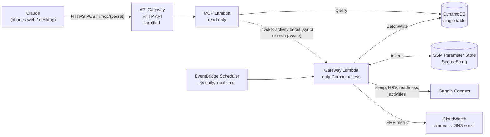

# Garmin Coach MCP

A serverless [Model Context Protocol](https://modelcontextprotocol.io) server on AWS that gives Claude access to my Garmin data (sleep, HRV, readiness, workouts) and computes training load (CTL/ATL/form) for a marathon build and IRONMAN California 2027.

It runs as a Claude custom connector, so I can ask questions from the Claude app on my phone, for example: *"How did my HRV respond to last week's long brick?"* or *"Is my ramp rate safe to add a fourth bike session?"*

Built with Terraform, Lambda (Python 3.12, arm64), API Gateway HTTP API, DynamoDB, EventBridge Scheduler, SSM Parameter Store and CloudWatch. It runs for about **$0–1/month**.

## Architecture



The system has two Lambdas, each with its own least-privilege IAM role:

| Component | Can do | Cannot do |
|---|---|---|
| **Gateway** | Read/write Garmin tokens, call Garmin, write DynamoDB | Be reached from the internet |
| **MCP server** | Query DynamoDB, invoke the gateway | See Garmin tokens, write data |

## Tools exposed to Claude

| Tool | What it returns |
|---|---|
| `get_daily_wellness` | Per day: sleep hours/score/stages, overnight HRV + status/baseline, resting HR, readiness, body battery, stress |
| `get_activities` | Workouts with pace/speed, HR, power, Garmin load, training effect; totals per sport |
| `get_activity_detail` | Live laps/splits and HR-zone time for one workout |
| `get_training_load` | Fitness (CTL), fatigue (ATL), form, acute:chronic ratio, per-sport 7/28-day load and hours, weekly trend |
| `get_weekly_summary` | Mon–Sun volume per sport plus average sleep, HRV, RHR, readiness |
| `get_fitness_snapshot` | VO2 max (run/bike), race predictions, Garmin training status, load focus |
| `get_race_calendar` | Goal races with weeks to go |
| `get_sync_status` / `refresh_data` | Data freshness; pull new workouts on demand |

## Setup

**Prerequisites:** an AWS account with the CLI configured, Terraform ≥ 1.10, and Python 3.12+.
Commands below work in PowerShell, macOS and Linux (use `python3` instead of `python` on macOS/Linux). On macOS/Linux, `make deploy`, `make bootstrap`, `make backfill` and `make url` are shortcuts.

```bash
# 1. Local tooling (in a virtual environment)
python -m venv .venv
.venv\Scripts\Activate.ps1          # macOS/Linux: source .venv/bin/activate
pip install -r scripts/requirements-local.txt -r requirements-dev.txt

# 2. Configure
cp terraform/terraform.tfvars.example terraform/terraform.tfvars   # edit goals, races, email

# 3. Build + deploy
python scripts/build.py
terraform -chdir=terraform init
terraform -chdir=terraform apply

# 4. Log in to Garmin once, on your own machine (handles MFA)
python scripts/bootstrap_garmin_auth.py --parameter /garmin-coach/garmin-tokens --region us-west-2

# 5. Load history so CTL is accurate from day one (6+ weeks needed; 180 days recommended)
python scripts/backfill.py --function garmin-coach-gateway --region us-west-2 --days 180

# 6. Get the connector URL (treat it like a password)
terraform -chdir=terraform output -raw mcp_connector_url
```

**Connect Claude:** In Claude (web or desktop), go to **Settings → Connectors → Add custom connector** and paste the URL. Enable the connector in a chat, then ask away. It's also available in the mobile app.

If you set `alert_email`, confirm the SNS subscription email AWS sends you.

## Cost

Estimated for a single athlete with ~20 questions/day and 4 syncs/day:

| Service | Usage | Cost/month |
|---|---|---|
| Lambda | < 5k invocations, mostly sub-second | $0 (free tier) |
| API Gateway HTTP API | < 1k requests | ~$0.00 |
| DynamoDB on-demand | ~2k writes, few k reads, < 5 MB | < $0.05 |
| EventBridge Scheduler | ~120 invocations | $0 (free tier) |
| SSM Parameter Store | 1 standard + 1 intelligent-tier param | $0–0.05 |
| CloudWatch | 2 alarms, 1 custom metric, 14-day logs | $0 (free tier) |

Guardrails: API throttling (5 rps, burst 10) caps runaway traffic, log retention is bounded, and nothing is always-on.

## Security design

- **No Garmin password in AWS.** Login (and MFA) happens locally. Only OAuth tokens go to SSM as a KMS-encrypted SecureString, and only the gateway role can read them.
- **Secret-path auth.** The connector URL contains a 48-character random token generated by Terraform. Wrong tokens get a `404`, compared in constant time. The token is never logged: API Gateway access logs record the route *template*, and the Lambda never logs paths.
- **Least privilege.** Separate roles per function, scoped to single ARNs. The internet-facing function can't touch credentials.
- **Blast radius.** The MCP surface is read-only except `refresh_data`, which only triggers a sync.
- **Terraform state contains the URL token.** Use the S3 backend in `terraform/backend.tf.example` (private, encrypted, native locking) rather than local state.

**Rotating the URL:** `terraform -chdir=terraform apply -replace=random_password.mcp_path_token`, then update the connector in Claude.

## Design decisions

- **Hand-rolled MCP transport instead of the SDK.** The MCP Python SDK's Streamable HTTP server expects a long-lived process. A tools-only server only needs `initialize`, `ping`, `tools/list` and `tools/call`, so `mcp_protocol.py` implements stateless JSON-RPC over HTTP in about 100 lines. It fits Lambda's request/response model and has no session store.
- **Sync to DynamoDB instead of proxying Garmin live.** This gives fast answers, keeps Garmin calls well under rate limits, and builds the 42+ days of history CTL needs. It also makes the unofficial API's occasional outages invisible until the next sync.
- **One function owns Garmin.** Token refreshes happen in one place, so two functions can never race to refresh and invalidate each other's session. Set `gateway_reserved_concurrency = 1` to make this airtight, if your account's concurrency quota allows it.
- **Single-table design.** `PK=DAY|ACT|META` + sortable `SK` dates means every tool is one `Query`. Fine for one athlete; multi-tenant would prefix PKs with a user id.
- **Load model.** Garmin's per-activity load is used when present, then HR-based TRIMP, then a duration × sport factor (e.g. swims without HR). CTL uses a 42-day EWMA and ATL a 7-day one. These are **not** TrainingPeaks TSS values, so trends matter more than absolute numbers.

## Operations

- **Sync failed alarm:** check `/aws/lambda/garmin-coach-gateway` logs. If it's an authentication error, run `make bootstrap` again.
- **Garmin changed something:** the unofficial `garminconnect` library usually ships a fix within days. Bump the pin in `app/gateway/requirements.txt` and `make deploy`.
- **Manual sync:** `aws lambda invoke --function-name garmin-coach-gateway --cli-binary-format raw-in-base64-out --payload '{"action":"sync","days":7}' /dev/stdout`

## Known limitations

- Garmin Connect has no public personal API; this uses the community [`python-garminconnect`](https://github.com/cyberjunky/python-garminconnect) library, which can break when Garmin changes its auth.
- Logging in from a cloud IP can trigger Garmin's security checks, which is why the bootstrap runs locally and AWS only refreshes tokens.
- Multisport handling assumes child legs appear in the activity list. If a triathlon shows up only as a parent, its load is counted once at the parent level.
- Path-token auth is simple but bearer-style: anyone with the URL has read access.

## Roadmap

- [ ] OAuth 2.1 authorization for the connector (replace path token)
- [ ] `create_workout` tool: push planned sessions to the watch via Garmin's workout API
- [ ] Planned-vs-actual tracking against a stored training plan
- [ ] Swim CSS and bike FTP trends for Ironman pacing

## Local development

```bash
pip install -r requirements-dev.txt
make test        # unit tests: load model, Garmin transforms, MCP protocol
make lint        # ruff + terraform fmt
```

Not medical advice. Training metrics are estimates.
